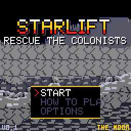

# STARLIFT

A rocket-lander rescue game for CHGame. Colonists are stranded across eight worlds. Fly your lander on Newtonian
physics, set down gently beside them, and carry them home to the base pad at the far end of each stage before the
flying saucers beam them away.

## Controls

| Button | |
|---|---|
| LEFT / RIGHT | Tilt the lander |
| A | Main engine (hold; it takes a moment to spool up) |
| DOWN, twice | Landing gear up or down |
| B | Rotary cannon and laser |
| START | Pause menu (resume, save, quit) |
| START held 3 s | Back to the CHGame menu |

## How to play

- **Fly.** Gravity pulls, the engine pushes along the hull, and nothing brakes for you. Each world has its own gravity
  (shown on the stage card, from 0.14 G to 0.64 G), and some have wind: watch the windsocks and the arrow on the screen.
  Colonists aboard make the lander heavier.
- **Land.** Gear down, level, and slowly. Too fast, too tilted, gear up or on a slope, and the lander is lost.
- **Rescue.** Colonists wave as you fly over. Land beside them (not on them!) and they run aboard: eight seats. Fly them
  to the base pad at the far end of the stage: they walk into the base, and the pad refuels and repairs the lander.
  Each stage has a quota of colonists to bring home; miss it and the world must be tried again.
- **Pick-ups.** Land beside a crate to load it: repair kits, fuel cells, colony supplies (deliver them to the base) and
  now and then an engine part that makes the lander stronger for the rest of the game.
- **The scanner** at the top shows the whole stage: colonists, enemies, items, the base. An arrow at the screen's edge
  points to the next job.

## Dangers

- **UFOs** hover over colonists and lift them up in shimmering green tractor beams. A saucer takes up to five, getting
  slower as it fills, then flies them to the aliens' collector at the far end of the stage. Shoot it down and its
  captives bail out on jet packs, and you can catch them in mid-air.
- **Stingers** spit plasma, **mines** drift towards you, **turrets** fire flak.
- **Sandworms** roam under the desert's sand. The ground heaves above them: get the colonists out before one rises, or
  shoot it as it surfaces to drive it back down.

## The worlds

Sixteen stages over eight worlds, each with its own sky, scenery, weather, wildlife and takeaway:

| World | |
|---|---|
| The Moon | The Earth overhead, the flag and the old descent stage, footprints in the dust. Burgers. |
| Sabulon | A deep desert of dunes and buried temples, sandstorms and sandworms. Noodles. |
| Cryo | A polar outpost under the aurora, domes and masts, snow blown by the wind. Ice cream. |
| Verda | A lost temple in the jungle under a banded gas giant, rain and lightning. Pizza. |
| Vulcan | Alien pylons among volcanoes, a red sun, ash and embers. Hot dogs. |
| Titan | A ring station under a ringed planet, methane drizzle. Fish and chips. |
| Prism | A crystal sanctum under twin suns, glinting air. Sushi. |
| Zorg | An alien city under two moons, acid rain. Glorp pies. |

The weather changes from game to game: a stage may be clear, or a storm.

## The SD card

STARLIFT keeps its music, its big pictures, its worlds and its words in **STARLIFT.DAT** on the SD card: copy it to the
card's root, and `Starlift.CHG` to `GAMES\GAMES`. Without the file the game asks for the card.

## Saving

START opens the pause menu: SAVE GAME keeps the stage, score and landers; the title offers CONTINUE. The high score
and the music and effects volumes (OPTIONS) are kept too.

## Building

    python tools/make_card.py        # sprites, songs, worlds, words -> out/card/STARLIFT.DAT and CHStarlift/CardIndex.h
    ./cl build                       # the game (flash <= 50,432 B, RAM <= 18,416 B)
    ./cl run CHStarlift/tools/scripts/look.txt out/look --card out/card/STARLIFT.DAT

The simulator needs the card file (`--card`). Test switches (`-D`): `SL_BOT` an autopilot, `SL_START=n` start at
stage n, `SL_STORM` the worst weather, `SL_TRACE` a log. A board perf run needs them in `CHStarlift/tools/game.py`
(`-D` does not reach the board build) and `SL_SLIM` so the debug image fits.

## Developer notes

- `CHStarlift/CHStarlift.ino` is the game; `Synth.cpp` the sound (three FM voices, drums, an engine rumble and an
  effects voice that can warble like a 1950s ray gun); `Card.cpp` reads STARLIFT.DAT through a small block cache, only
  between `gfx_wait()` and the flush.
- The scenery: a sky, three parallax layers (1/8, 1/4, 1/2 of the camera) drawn column by column, each stopping where
  the next begins, with buildings from the card on them, then the ground in textured bands.
- `tools/`: `make_sprites.py` (with `structures.py`, `bases.py`, `plants.py`, `skies.py`, `life.py`), `make_music.py`,
  `messages.txt`, and `make_card.py`, which also holds the eight worlds' definitions.

## Credits

Game, code, art and music by Jadflat, made with Claude (Anthropic). The pixel art was drawn as grids and rendered with
the author's CHGame-tuned "pixel-art-gen" Claude skill.

Built on CHGame, Copyright 2026 Kevin Bates (bateske), Apache-2.0: the framework is vendored in `chgame/` (see
`chgame/NOTICE` and `chgame/LICENSE`). The sound output's timer setup follows chgame-soundtracks (BSD 3-Clause): see
[THIRD-PARTY.md](THIRD-PARTY.md).

## Licence

The game's own code, art and music: MIT (see [LICENSE](LICENSE)). `chgame/`: Apache-2.0.
